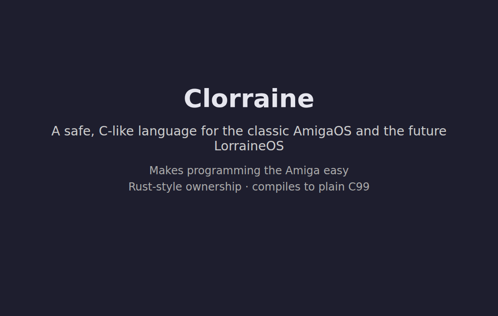

# Clorraine

Clorraine is the systems language of **LorraineOS** — a bare-metal Amiga OS for
the Motorola 68000 family, with an ARM64 port planned.

Clorraine is a safe, C-like language with Rust-style ownership and borrow
checking. It is designed for systems programming first and compiles to plain C,
so the generated code runs on the existing Amiga toolchains and, later, on
ARM64.

Like C and Unix — and later Oberon — the language and the OS are co-designed:
LorraineOS requirements drive Clorraine's feature set, and Clorraine exists to
make LorraineOS (and Amiga programs) safe and pleasant to write.

## Demo



The demo tells the Clorraine story in chapters: a card introducing Clorraine,
the smallest Clorraine program
([`examples/hello/hello.clo`](examples/hello/hello.clo)) highlighted with
syntax coloring, a card explaining what it shows, and the same program running
under FS-UAE (the Amiga emulator). It continues with a real program,
`string-parser`: its source, a card on the ownership checker and the
move-then-use it rejects
([`examples/ownership-fail.clo`](examples/ownership-fail.clo)), the
one-command build, the `hosted-amiga` run, and that program under FS-UAE. It
then draws — a rotating 3D cube drawn line by line on a custom Amiga screen
under FS-UAE — and closes with a card on LorraineOS, the project Clorraine
belongs to.

The full video (`demo/demo-full.mp4`), the opening loop (`demo/demo.gif`), and
`demo/emulator.mp4` are generated from the story script `demo/story.ts` by the
toolkit in `tools/demo/`. Run `make demo` to rebuild them (and
`make demo-check` to type-check and test the toolkit). Generated media is not
committed; `demo/poster.png` is the one checked-in still.

## Status

Early development. The reproducible Docker toolchain, the frozen specification,
and the compiler MVP are in place: `clc` compiles the corpus subset of the
specification to one C99 translation unit for the `host` and `hosted-amiga`
profiles, and the host and target acceptance suites are green.

| Component | State |
|---|---|
| Amiga SDK image (GCC 16.2, binutils 2.46, gdb, libnix, NDK 3.2, vbcc/vasm/vlink) | Ready |
| FS-UAE + `vamos` run/debug loop (`make run`, `make run-vamos`, ADF fallback) | Ready |
| Phase 0 hosted skeleton (ownership contracts, cleanup shapes, run matrix) | Complete |
| Language specification v0.4 — Phase A decisions, Phase B grammar freeze, Phase C chapter rewrites, Phase D compile-fail suite ([spec](spec/README.md)) | v0.4, frozen for the MVP; the compiler targets its corpus subset |
| Compiler MVP (C-like → C with ownership checks) | Implemented; `make check` and `make verify` green |
| Validation corpus (`spec/tests/corpus/`) | Passes on host and hosted-amiga (GCC + `vamos`, FS-UAE, vbcc build) |
| LorraineOS bring-up (freestanding profile, m68k) | With/after the MVP |
| ARM64 port | Later |

## Repository layout

```
compiler/  The `clc` compiler: Rust front end, checker, and C99 emitter
stdlib/    The embedded standard-library `.clo` sources
spec/      The language specification, grammar, and golden test data
docker/    The Clorraine SDK: pinned, from-source Amiga toolchain in Docker
docs/      Findings and review records
plans/     CodeOps feature plans and the roadmap
spikes/    Phase 1 toolchain spikes
```

## Quick start

```sh
cd docker
make image     # build the SDK image (first time only, compiles the toolchain)
make init      # create docker/.env and ~/amiga for ROMs/ADFs
make smoke     # verify the toolchain
make shell     # interactive development shell
```

See [docker/README.md](docker/README.md) for workflows, the program runner,
ROM policy, X11 troubleshooting, and how to update the toolchain.

## Organization

Developed under [OpenLorraine](https://github.com/OpenLorraine). LorraineOS
lives in its own repository.

## License

To be determined.
