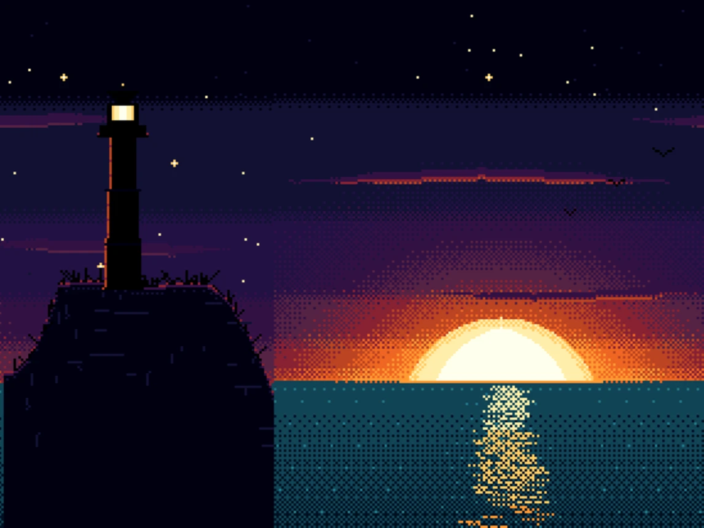
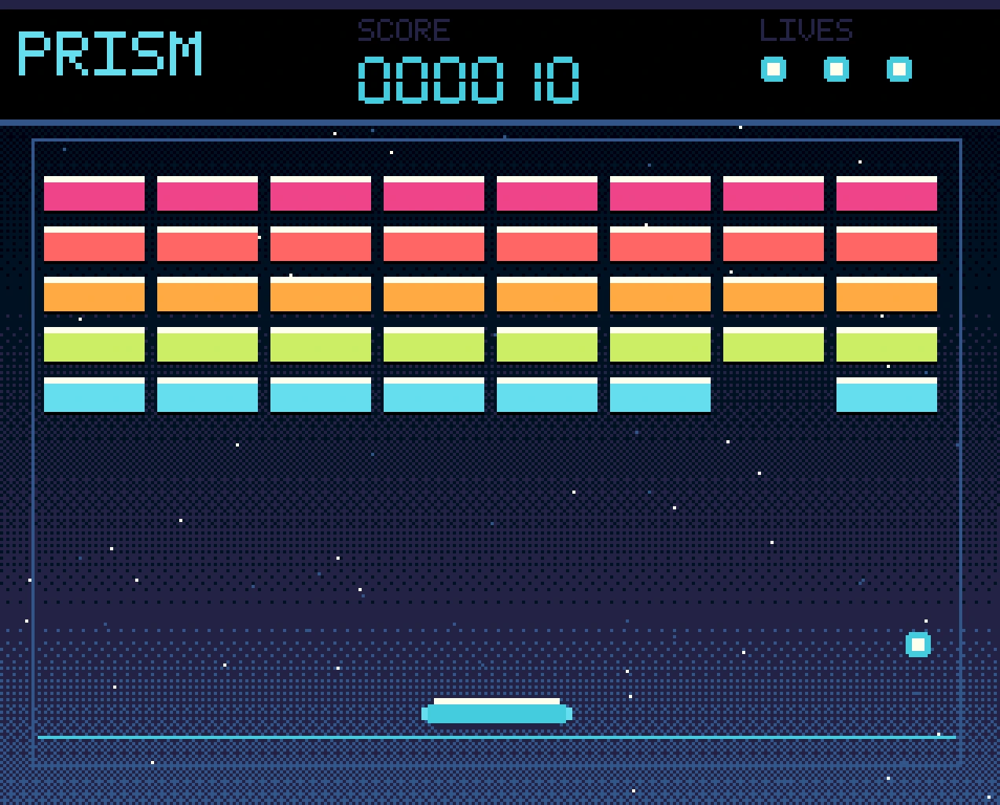
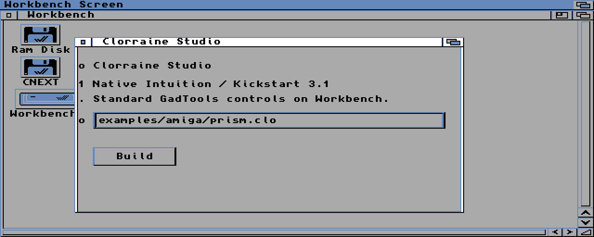

<p align="center">
  
</p>

# Clorraine

> **Project status: developer preview.** Clorraine is under active
> development. The compiler core is usable today for the supported language
> and Amiga SDK surface, but installation, packaging, editor integration, and
> some platform support are still in progress. Expect changes; do not rely on
> it for production work yet. See
> [Known limitations](docs/known-limitations.md), the
> [latest release](https://github.com/OpenLorraine/clorraine/releases), and the
> [documentation site](https://openlorraine.github.io/clorraine/).

| Area | State |
|---|---|
| Compiler, checker, ownership, C99 emission | Usable; guarded by the specification and test suites |
| Amiga SDK and four profiles | Implemented for the tracked surface; tested on emulator and target legs |
| Linux x86_64 binary | Released (v1.1.2) |
| VS Code extension | Packages and passes its packaged-client test (`make vscode-check`) |
| Windows/macOS installers | In progress |
| Documentation site | Developer preview published at [openlorraine.github.io/clorraine](https://openlorraine.github.io/clorraine/) |

Clorraine is the systems language of **LorraineOS** — a bare-metal Amiga OS for
the Motorola 68000 family.

Clorraine is a safe, C-like language with Rust-style ownership and borrow
checking. It is designed for systems programming first and compiles to plain C,
so the generated code runs on the existing Amiga toolchains.

Like C and Unix — and later Oberon — the language and the OS are co-designed:
LorraineOS requirements drive Clorraine's feature set, and Clorraine exists to
make LorraineOS (and Amiga programs) safe and pleasant to write.

## Showcases

Four programs written in Clorraine. Boing, First Light, and Prism are A500
programs that run live in the browser from the
[examples site](https://openlorraine.github.io/clorraine/examples/), where each
ADF is also downloadable. Clorraine Studio is a native Intuition application on
Workbench 3.1.

| Boing: Neon Horizon | First Light |
|:---:|:---:|
|  |  |
| **A500 · 32 colours · live in the browser** | **A500 · 16 colours · live in the browser** |
| **Prism** | **Clorraine Studio** |
|  |  |
| **A500 · arcade · keyboard or joystick** | **A1200 · Kickstart 3.1 · native Workbench** |

The programs live in [`examples/amiga/`](examples/amiga). To play the A500 demos
locally at full speed, `tools/amiga/play-demo.sh <demo>` boots the committed ADF
in FS-UAE with your own licensed Kickstart 1.3 image.

## Demo

The demo tells the Clorraine story in chapters: a card introducing Clorraine,
the smallest Clorraine program
([`examples/hello/hello.clo`](examples/hello/hello.clo)) highlighted with
syntax coloring, a card explaining what it shows, and the same program running
under FS-UAE (the Amiga emulator). It continues with a real program,
`string-parser`: its source, a card on the ownership checker and the
move-then-use it rejects
([`examples/ownership-fail.clo`](examples/ownership-fail.clo)), the
one-command build, the `hosted-amiga` run, and that program under FS-UAE. It
then draws — a rotating 3D cube drawn line by line on a custom Amiga screen
under FS-UAE — and closes with a card on LorraineOS, the project Clorraine
belongs to.

The full video (`demo/demo-full.mp4`), the opening loop (`demo/demo.gif`), and
`demo/emulator.mp4` are generated from the story script `demo/story.ts` by the
toolkit in `tools/demo/`. Run `make demo` to rebuild them (and
`make demo-check` to type-check and test the toolkit). Generated media is not
committed; `demo/poster.png` is the one checked-in still.

## Editor and tooling

- **Language server** — `clorraine-lsp` speaks LSP over stdio and provides
  diagnostics, hover, go to definition, completion, and document symbols.
  Build it with `make -C docker exec CMD="cargo build --workspace"`.
- **VS Code extension** — `tools/vscode/` launches the server and registers the
  canonical grammar; `make vscode-check` packages and audits a `.vsix`.
- **SDK installer** — `make setup` detects Docker, the pinned image, the
  toolchain, the NDK, and licensed media; `make setup FETCH=1` builds missing
  public components without ever downloading media.
- **Reference documentation** — `clorraine --doc -o build/api FILE...` renders
  `///` comments as linked Markdown.
- **Documentation site** — the developer preview is at
  [openlorraine.github.io/clorraine](https://openlorraine.github.io/clorraine/).
  `site/` is a VitePress package; `make site-dev` previews it locally and
  `make site-check` performs a clean install and a production build.
- **C to Clorraine** — [the Rosetta guide](docs/c-to-clorraine.md) translates
  the common Amiga C patterns and the diagnostics they meet.

## Status

Clorraine v1.1.2 is the current release. The reproducible Docker toolchain, the
stable v1.0 specification, and the approved v1.1 language surfaces are in place:
`clc` compiles the corpus subset and the v1.1 surfaces to one C99 translation
unit for the `host`, `hosted-amiga`, `hosted-amiga-13`, and `freestanding`
profiles, and the host and target acceptance suites are green. The
`hosted-amiga-13` profile targets a stock A500 with Kickstart 1.3; the Amiga SDK
registry tracks the remaining native surface.

| Component | State |
|---|---|
| Amiga SDK image (GCC 16.2, binutils 2.46, gdb, libnix, NDK 3.2, vbcc/vasm/vlink) | Ready |
| FS-UAE + `vamos` run/debug loop (`make run`, `make run-vamos`, ADF fallback) | Ready |
| A500/Kickstart 1.3 profile (`hosted-amiga-13`) | Ready; part of `make verify` |
| Language specification v1.0 — Phase A decisions, Phase B grammar freeze, Phase C chapter rewrites, Phase D compile-fail suite ([spec](spec/README.md)) | stable (v1.0); frozen; the compiler implements its corpus subset plus generics, lambdas, volatile/MMIO, and the approved v1.1 surfaces |
| v1.1 language surfaces: `Box<T>`, ordinary `freedBy` deleters, C-hook trampolines | Implemented; specification and implementation suites green |
| Compiler (C-like → C with generics, lambdas, volatile/MMIO, and optimized emission) | Implemented; `make check` and `make verify` green |
| Borrow checker (non-lexical lifetimes, v2 model) | Implemented; NLL and the v2 borrow model are green under `make check` |
| Verification (UBSan leg and deterministic differential fuzzer) | `make ubsan` and `make fuzz-smoke` are part of the gate |
| Validation corpus (`spec/tests/corpus/`) | Passes on host and hosted-amiga (GCC + `vamos`, FS-UAE, vbcc build) |
| Freestanding (m68k, no-libc) profile | Implemented; LorraineOS bring-up is a separate downstream project |

## Repository layout

```
compiler/  The `clc` compiler and `clorraine` driver: Rust front end, checker, and C99 emitter
stdlib/    The embedded standard-library `.clo` sources
spec/      The language specification, grammar, and golden test data
docker/    The Clorraine SDK: pinned, from-source Amiga toolchain in Docker
docs/      Findings and review records
examples/  Small programs, including the Amiga showcases
site/      The public VitePress documentation site
tools/     Demo renderer, benchmark and fuzz harnesses, SDK setup, VS Code extension, and the local demo launcher
plans/     CodeOps feature plans and the roadmap
spikes/    Phase 1 toolchain spikes
```

## Quick start

```sh
cd docker
make image     # build the SDK image (first time only, compiles the toolchain)
make init      # create docker/.env and ~/amiga for ROMs/ADFs
make smoke     # verify the toolchain
make shell     # interactive development shell
```

See [docker/README.md](docker/README.md) for workflows, the program runner,
ROM policy, X11 troubleshooting, and how to update the toolchain.

## Organization

Developed under [OpenLorraine](https://github.com/OpenLorraine). LorraineOS
lives in its own repository.

## Known limitations

The accepted limitations of the v1.0 and v1.1 releases are recorded in
[docs/known-limitations.md](docs/known-limitations.md).

## License

Clorraine is open source under the OSI-approved
[Apache License 2.0](LICENSE), with the
[Clorraine Output Exception](LICENSE-EXCEPTION.md).

You may use, modify, and distribute Clorraine, including commercially. You may
sell software built with it. Apache 2.0 also permits redistributing or selling
copies of the compiler itself. The compiler's runtime and standard-library code
embedded in your programs may be distributed under your own terms, including
proprietary terms. You do not need permission to fork Clorraine, bundle it in
an IDE or SDK, or sell support; the trademark policy applies to the Clorraine
name and logo.

The [trademark policy](TRADEMARKS.md) explains how the Clorraine name and logo
may be used. Third-party notices for ported source and vendored definitions are
in [THIRD_PARTY_NOTICES.md](THIRD_PARTY_NOTICES.md).
