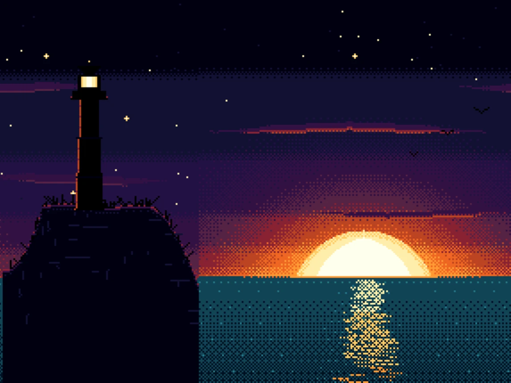
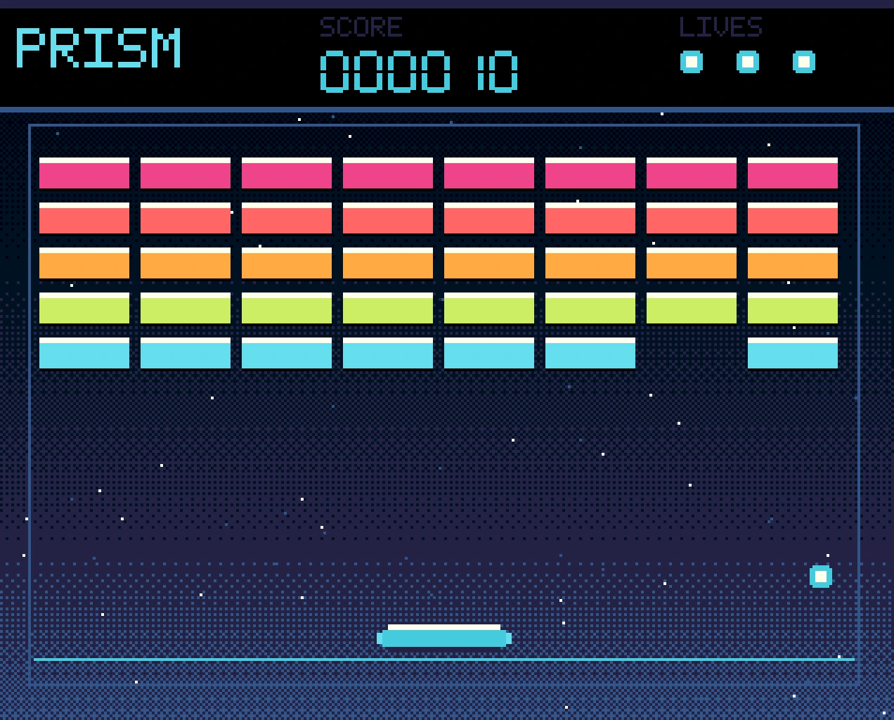
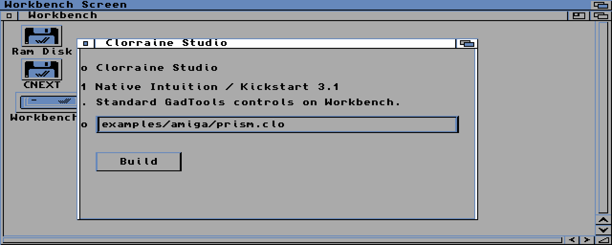

<p align="center">
  
</p>

# Clorraine

> **Developer preview.** Clorraine is under active development. The v1.2.0
> Linux build is a public prerelease; expect changes. Windows and macOS are on
> the way.

Clorraine is a safe, C-like language for the Amiga and LorraineOS. It has
Rust-style ownership and borrow checking, compiles to plain C, and runs on the
existing Amiga toolchains. The language and LorraineOS are designed together.

## Install on Linux

Linux x86_64, glibc 2.38 or newer. One command:

```sh
curl -fsSL https://github.com/OpenLorraine/clorraine/releases/download/v1.2.0/install.sh -o clorraine-install.sh && sh clorraine-install.sh
```

The installer asks where to install (default `~/.local`), offers to add it to
your PATH, verifies the download, installs `clc`, `clorraine`, and
`clorraine-lsp`, sets up the rc24 Amiga toolchain (downloaded or an existing
copy), and runs a hello test.

You supply a licensed Kickstart ROM; Clorraine does not bundle the toolchain or
the ROM. The [Linux CLI guide](docs/linux-cli.md) and the
[release page](https://github.com/OpenLorraine/clorraine/releases/tag/v1.2.0)
have the details, including checksum verification and the VS Code extension.

**Windows and macOS are on the way.**

## See what it can do

| Boing: Neon Horizon | First Light |
|:---:|:---:|
|  |  |
| **A500 · 32 colours · play in the browser** | **A500 · 16 colours · play in the browser** |
| **Prism** | **Clorraine Studio** |
|  |  |
| **A500 · arcade · keyboard or joystick** | **A1200 · Kickstart 3.1 · native Workbench** |

[Play the A500 demos in your browser →](https://openlorraine.github.io/clorraine/examples/)

## Learn more

Everything below goes deeper than this page:

- [Documentation](https://openlorraine.github.io/clorraine/)
- [Linux CLI guide](docs/linux-cli.md)
- [Known limitations](docs/known-limitations.md)
- [Language specification](spec/README.md)
- [C to Clorraine guide](docs/c-to-clorraine.md)
- [Examples](examples/)
- [All releases](https://github.com/OpenLorraine/clorraine/releases)

## License

Clorraine is open source under the [Apache License 2.0](LICENSE), with the
[Clorraine Output Exception](LICENSE-EXCEPTION.md).

Built by [OpenLorraine](https://github.com/OpenLorraine). LorraineOS is a
separate project.
